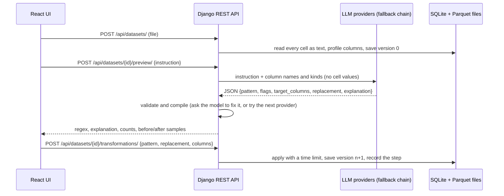

# RegexFlow: find and replace in spreadsheets with plain English

Upload a CSV or Excel file, describe what to find ("email addresses", "Australian mobile numbers"), and RegexFlow asks a large language model to write the regular expression. You see the regex, an explanation, match counts and before/after examples, then apply the replacement as a step that you can undo.

Built with **Django + Django REST Framework** and **React + TypeScript**.

- **Live demo:** _to be added_
- **Demo video:** _to be added (embedded below)_

<!-- Demo video goes here -->

## Features

- **Upload** CSV, TSV, XLSX or XLS files (50 MB by default) and browse them in a paginated table.
- **Describe the pattern in plain English.** An LLM turns it into a Python regular expression, picks the target columns when you name them, and reads the replacement from your sentence when you include one.
- **Preview before changing anything:** the generated regex (editable), a one-line explanation, matches per column, and before/after examples with matched text highlighted.
- **Apply as a step.** Steps form a history with undo, and the cells changed by the latest step are highlighted in the table.
- **Write a regex yourself** when you prefer, or when no LLM is available.
- **Download** the processed data as CSV or Excel.

The brief's example works as written: on a table with `ID, Name, Email`, the instruction *"Find email addresses in the Email column and replace them with 'REDACTED'"* produces an email regex limited to the `Email` column and replaces every address with `REDACTED`. The API test suite covers this exact scenario.

## How it works



## Design decisions

1. **The LLM only sees the instruction and column metadata.** Cell values never leave the server. This protects user data (free API tiers may use prompts for training), keeps each call to a few hundred tokens, and means a 10-row file and a 500,000-row file cost the same: the regex runs locally over all rows.
2. **Structured output and defensive parsing.** The model must return a JSON object (enforced by JSON-schema / JSON mode where the provider supports it). Replies are parsed tolerantly: markdown fences, unescaped regex backslashes and JSON's `\b`-means-backspace mistake are repaired. Backslashes escaped twice (`\\d` instead of `\d`) are caught as well: such a pattern looks for literal backslashes and finds nothing, so if the single-escaped version matches the data, that version is used. Each suggestion is validated: the regex must compile and the columns must exist. If it is invalid, the model gets one chance to fix it, with the error message as feedback. If that fails too, or the provider is down or rate-limited, the next provider is tried. Answers are cached by instruction + columns.
3. **Provider-agnostic, free by default.** Gemini, Groq and local model servers (Ollama, llama.cpp, vLLM, LM Studio) all speak the OpenAI Chat Completions API, so a single provider class covers them. Their order and models come from environment variables. The default chain is the Gemini free tier, then the Groq free plan. Free tiers drop requests when they are busy, so each provider gets one attempt with a 15-second limit and no automatic retries. A stuck request hands over to the next provider within seconds instead of a minute.
4. **Untrusted regexes are handled safely.** Patterns are compiled with the [`regex`](https://pypi.org/project/regex/) module and every request has a time budget, so catastrophic backtracking returns a clear error instead of hanging a worker. Patterns that would match empty text inside a value (`\d*`, `\b`) are rejected, while `^$` for empty cells is allowed. Replacements are inserted literally, so `\1` in the user's text stays `\1`.
5. **The data keeps its exact text.** Every cell is read as a string, so phone numbers, postcodes and IDs keep their leading zeros. Encoding (UTF-8, BOM, legacy code pages) and the delimiter (`,` `;` tab `|`) are detected, and blank or duplicate headers are cleaned up. Each column gets a kind (text, numeric, date, boolean, empty), which decides the default target: the "text columns" from the brief.
6. **Preview, then apply as versioned steps.** Each applied step writes a new Parquet version and a `Transformation` row with its pattern, replacement, columns and counts. Undo removes the latest step, and changed cells are found by comparing the current page with the previous version.
7. **Thin views, explicit layers.** `views` → `services.operations` → `file_reader`, `regex_engine`, `storage`, `generation` → `llm`. The `llm` package knows nothing about datasets or HTTP. Errors are typed exceptions rendered as one JSON shape: `{"error": {"code", "message", "details"}}`.
8. **Safe to expose publicly.** Uploads and LLM calls have per-IP rate limits, so strangers cannot drain the free quota. Upload size is capped, and datasets are deleted after 24 idle hours; the cleanup runs on upload, so no cron is needed. Datasets are addressed by random UUIDs and there is no endpoint that lists them.

## Tech stack

| Layer | Choice |
| --- | --- |
| Backend | Python 3.13, Django 5.2 LTS, Django REST Framework 3.18, pandas 3.1 + PyArrow, openpyxl / xlrd, regex, pydantic, openai SDK (for OpenAI-compatible APIs) |
| Frontend | React 19, TypeScript 7, Vite 8, plain CSS with light and dark themes |
| Tests | pytest + pytest-django, Vitest + Testing Library |
| Serving | gunicorn + WhiteNoise: one container serves the API and the built React app |

## Project structure

```
backend/
  config/                 Django settings, root URLs, SPA view
  datasets/               Django app: models, serializers, views, URLs
    services/
      operations.py       use cases: upload, page, preview, apply, undo, export, cleanup
      file_reader.py      CSV / Excel parsing (everything as text)
      column_profile.py   column kind inference
      regex_engine.py     safe compile / replace with timeouts
      storage.py          versioned Parquet files
      generation.py       bridge from datasets to the llm package
    exception_handler.py  one JSON error format for the whole API
    tests/
  llm/                    LLM layer, independent of Django models
    prompts.py            system prompt, few-shot examples, JSON schema
    providers.py          OpenAI-compatible provider + factory from settings
    generator.py          parsing, validation, repair, fallback, caching
    tests/
frontend/
  src/
    api/                  typed API client
    components/           UploadPanel, TransformPanel, PreviewCard, StepsList, DataTable...
    utils/                span highlighting helpers
Dockerfile                multi-stage build (Node builds the UI, Python serves everything)
```

## Running it locally

Requirements: Python 3.12+ and Node.js 22+ (developed with Python 3.13 and Node 26).

### 1. Get a free LLM API key

- **Gemini** (recommended): create a key at <https://aistudio.google.com/apikey>. The free tier needs no credit card; if you never link a billing account you cannot be charged, and hitting the limit only returns an error.
- **Groq** (optional fallback): create a key at <https://console.groq.com/keys>.

Without any key the app still works, with hand-written regexes only.

### 2. Backend

```bash
cd backend
python -m venv .venv
source .venv/bin/activate          # Windows: .venv\Scripts\activate
pip install -r requirements-dev.txt
cp .env.example .env               # Windows: copy .env.example .env
# edit .env and set GEMINI_API_KEY (and GROQ_API_KEY if you have one)
python manage.py migrate
python manage.py runserver         # http://localhost:8000
```

### 3. Frontend

```bash
cd frontend
npm install
npm run dev                        # http://localhost:5173 (proxies /api to :8000)
```

Alternatively, run `npm run build` once and open <http://localhost:8000>: Django serves the built app.

### Using your own model (optional)

Any OpenAI-compatible server works. For example, with [Ollama](https://ollama.com/) serving your model, add to `backend/.env`:

```
LLM_PROVIDERS=local,gemini
LOCAL_LLM_BASE_URL=http://localhost:11434/v1
LOCAL_LLM_MODEL=your-model-name
```

The local model is tried first and Gemini is the fallback. Set `LOCAL_LLM_JSON_MODE` to `json_schema`, `json_object` or `none`, depending on what your server supports. Local models are often slower than hosted ones: if yours needs more than 15 seconds per reply, raise `LLM_TIMEOUT_SECONDS`.

## Configuration

All settings are environment variables (see [`backend/.env.example`](backend/.env.example)).

| Variable | Default | Purpose |
| --- | --- | --- |
| `DJANGO_DEBUG` | `false` | Development mode |
| `DJANGO_SECRET_KEY` | — | Required when `DJANGO_DEBUG=false` |
| `DJANGO_ALLOWED_HOSTS` | `localhost,127.0.0.1` | Host names the app answers to |
| `LLM_PROVIDERS` | `gemini,groq` | Providers to try, in order (`gemini`, `groq`, `local`) |
| `GEMINI_API_KEY` / `GEMINI_MODEL` | — / `gemini-3.1-flash-lite` | Google Gemini API |
| `GROQ_API_KEY` / `GROQ_MODEL` | — / `openai/gpt-oss-120b` | Groq |
| `LOCAL_LLM_BASE_URL` / `LOCAL_LLM_MODEL` | `http://localhost:11434/v1` / — | Your own OpenAI-compatible server |
| `LLM_TIMEOUT_SECONDS` | `15` | How long one provider may take before the next is tried (no retries) |
| `LLM_RATE_LIMIT` / `UPLOAD_RATE_LIMIT` | `60/hour` / `30/hour` | Per-IP limits |
| `MAX_UPLOAD_SIZE_MB` | `50` | Upload size limit |
| `DATASET_TTL_HOURS` | `24` | Idle datasets older than this are deleted (`0` keeps them) |
| `REGEX_TIMEOUT_SECONDS` | `10` | Time budget for applying a pattern |
| `DATA_DIR` | `backend/var` | Where the SQLite database and uploaded data live |
| `NUM_PROXIES` | — | Reverse proxies in front of the app, so rate limits see real client IPs |

## API

| Method | Path | Purpose |
| --- | --- | --- |
| `POST` | `/api/datasets/` | Upload a file (multipart field `file`) |
| `GET` | `/api/datasets/{id}/` | Dataset metadata, columns and steps |
| `DELETE` | `/api/datasets/{id}/` | Delete the dataset and its files |
| `GET` | `/api/datasets/{id}/rows/?page=1&page_size=50` | One page of the current version, with the cells the latest step changed |
| `POST` | `/api/datasets/{id}/preview/` | Generate a regex from `instruction` (or check a given `pattern`) and preview it; changes nothing |
| `POST` | `/api/datasets/{id}/transformations/` | Apply a replacement as a new step (an `instruction` alone also works) |
| `POST` | `/api/datasets/{id}/transformations/undo/` | Undo the latest step |
| `GET` | `/api/datasets/{id}/export/?file_type=csv` | Download the current version (`csv` or `xlsx`) |
| `GET` | `/api/health/` | Health check, limits and configured LLMs |

```bash
curl -F file=@people.csv http://localhost:8000/api/datasets/
curl -X POST http://localhost:8000/api/datasets/<id>/transformations/ \
     -H "Content-Type: application/json" \
     -d '{"instruction": "Replace email addresses in the Email column with REDACTED"}'
```

Errors always look like `{"error": {"code": "invalid_pattern", "message": "Invalid regular expression: missing ) at position 5."}}`. Codes include `unsupported_file_type`, `file_too_large`, `file_parse_error`, `invalid_pattern`, `regex_timeout`, `column_not_found`, `missing_replacement`, `no_changes`, `pattern_not_expressible`, `llm_not_configured`, `llm_unavailable`, `rate_limited`, `dataset_not_found`, `dataset_expired` and `nothing_to_undo`.

## Tests

```bash
cd backend && pytest               # parsing, regex safety, LLM parsing / repair / fallback, API end to end
ruff check . && ruff format --check .
cd frontend && npm test            # components, API client, highlighting helpers
```

The backend tests never call a real LLM: they script provider replies with `llm.testing.FakeProvider`.

## Docker

```bash
docker build -t regexflow .
docker run -p 8000:8000 \
  -e DJANGO_SECRET_KEY=change-me -e DJANGO_ALLOWED_HOSTS=localhost \
  -e GEMINI_API_KEY=your-key regexflow
```

Mount a volume at `/data` to keep uploads across restarts.

## Deployment

The live demo runs on [Render](https://render.com)'s free plan in the Singapore region, as described in [`render.yaml`](render.yaml):

1. In the Render dashboard choose **New → Blueprint** and select this repository.
2. Enter `GEMINI_API_KEY` (and `GROQ_API_KEY` for the fallback) when asked; `DJANGO_SECRET_KEY` is generated for you.
3. Render builds the Dockerfile and redeploys on every push to `main`.

Free-plan constraints shape the configuration: with 512 MB of RAM the service runs one gunicorn process with four threads and accepts uploads up to 10 MB. It spins down after 15 idle minutes and takes about a minute to wake up, and its disk is temporary, so uploaded datasets disappear when it does.

## Limitations and next steps

- Files are processed in memory within the request, which is fine at the default 50 MB. Much larger files would move to background jobs (Celery or RQ) with progress polling, and to chunked processing.
- Only the first sheet of a workbook is read.
- The LLM answer cache and the rate limits live in each worker's memory; a shared Redis cache would make them global.
- Uploads live on the container's disk; production would use a mounted volume or object storage.
- More LLM-powered transformations would fit the step pipeline, such as standardising formats (DD/MM/YYYY dates to ISO 8601) or splitting a column in two.
